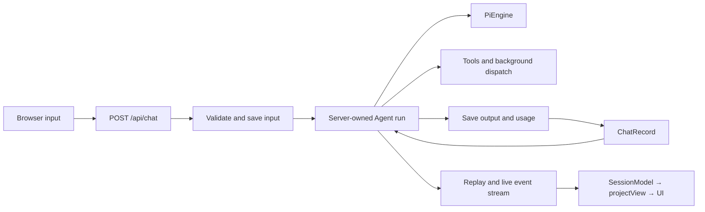
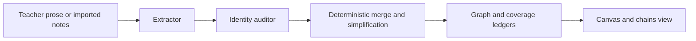

# Architecture

LearnHarness is a Next.js application with an Electron desktop host. The server owns agent runs, conversation records, background work, and filesystem persistence; the browser projects those records into a lesson/practice UI and knowledge graph.

This reference describes the [repository source](README.md#about-these-docs). See [Development](development.md) for commands and [the teaching theory](teaching-methodology.md) for pedagogical intent.

## Code boundaries

| Area | Responsibility / starting points |
| --- | --- |
| `app/` | Pages and HTTP transport; `api/chat/route.ts`, `api/chats/` |
| `components/` | Browser state and presentation; `session-core.ts`, `chat.tsx`, `graph-view.tsx` |
| `src/server/` | Composition, admission, liveness, HTTP-facing services; `chat-handler.ts`, `jobs.ts`, `stores.ts` |
| `src/agent/` | Agent construction, tools, provider streams, workers; `teacher-agent.ts`, `models.ts`, `tools.ts`, `subagents/` |
| `src/core/` | Contracts, record/view projections, domain algorithms; `input-events.ts`, `native-messages.ts`, `view.ts`, `graph.ts` |
| `src/store/` | Filesystem adapters for chats, jobs, graph, settings, and credentials |
| `electron/` | Desktop launch, navigation/permission guards, credential transport, browser helper, updater |

[`eslint.config.mjs`](../eslint.config.mjs) restricts shell imports into `src/` to the core/server barrels, prevents core imports from IO layers, and prevents agents importing server/store adapters. Dependencies arrive through injected contexts/ports. These rules are not a proof of pure core, one composition root, or one writer per store: some core modules are Node-bound and excluded from the browser barrel; server modules can import adapters. Scripts, Electron, and tests are outside these zones.

## Conversations and turns

A **conversation** is a durable `ChatRecord` with native `LhMessage[]`, settings, optional plan, and usage logs. Missing `kind` means teaching; `practice` selects the practitioner. An **engine** is the resolved Pi model, stream function, and thinking level. An application **turn** constructs a fresh native Pi `Agent` from saved history; it can make several model calls and execute tools. It is not an HTTP connection or a single generation.

[`chat-handler.ts`](../src/server/chat-handler.ts) resolves readiness, waits for compaction, re-reads durable truth, and claims per-chat liveness. A competing turn gets **409**. Accepted input is saved before inference; subscription automatic inputs can instead remain staged until dispatch admission. The HTTP response acknowledges admission, while `GET /api/chats/:id/stream` carries replay/live events and a terminal state.

The stored record has two projections:

- [`toLlmMessages`](../src/core/native-messages.ts) strips app metadata, flattens model-facing markers, applies the active compaction cut, and repairs eligible interrupted tool pairs at the provider boundary.
- [`projectView`](../src/core/view.ts) derives UI messages, question/problem docks, and artifacts. It is not the stored format or provider wire.
- [`findUnits` / `findHits`](../src/core/find-text.ts) are the one pure extractor behind Find: stored messages + projected view + side threads → searchable units (kind, unit label, time, order, blocks) and newest-first hits. Matching lives in [`find-match.ts`](../src/core/find-match.ts) (case- and accent-insensitive, `ß`→`ss`, whitespace runs as one space, original UTF-16 offsets). Text never revealed to the learner (a hidden pending question, a problem's `modelSolution` before conclude) is not extracted.

Pi seeds the system prompt/tools at construction; that synthetic system message is not persisted. New turns therefore get current instructions. The app does not use the AI SDK's client-transcript replacement or `addToolOutput` loop.

Settlement persists new native messages, plan snapshots, and usage, including partial output on abort. Failed input writes refuse inference; failed reply writes are surfaced before the terminal and do not masquerade as successful empty turns. Cleanup releases liveness. A memory-only failure notice can inform reattaching views without fabricating saved transcript content.

### Streaming and recovery

[`pi/ui-stream.ts`](../src/server/pi/ui-stream.ts) emits native agent events. Partial-message updates replace a slot; they are not accumulated text deltas. Replay retains settled events and the latest in-flight updates, with coalesced live fan-out. Tool IDs are uniquified against history so persistence, answer routing, and provider context agree.

Disconnecting a browser detaches a view, not the agent. Explicit abort is separate. [`session-core.ts`](../components/session-core.ts) owns reattachment, bounded 409 recovery, and adoption of canonical state. One recovery attachment is allowed after premature EOF/read failure; repeated transport failure shows an error.

Question drafts survive optimistic unmount in memory. Uncertain submissions reconcile the saved record and running state before resending, scoped to the same question occurrence. Provider-response retry is explicit: it preserves failed attempts on disk while omitting the eligible failed tail from temporary model context. The latest effect-free teacher reply to a learner input can also be retried: it moves to `retiredReplies` (kept, never shown or sent to a model) and the turn runs again from that input on the chat's current model. It is not mount-time replay or automatic retry of arbitrary failures.

### Drawn history

The session view draws only the newest part of a long session (plan 003). The cut is render-only: the client keeps the whole session, and every whole-history fold, the GET sync and the merge model are unchanged. [`core/drawn-history.ts`](../src/core/drawn-history.ts) picks the start (about 270 KB of newest content, extended back to just after a learner input; a session within the budget, or with under a quarter budget of earlier history, is drawn whole). [`chat.tsx`](../components/chat.tsx) anchors the start to a message id, so appends, GET replaces and streaming never move it, and nothing un-draws while the `Chat` lives; a new open or reload cuts afresh, also in the server HTML. Rows and parts before the start render `null`, keeping their indices. [`earlier-history-divider.tsx`](../components/earlier-history-divider.tsx) offers **Show earlier** (one more budget step) and **Show all**, keeping the reading position. The window event `lh:draw-to-message` (`detail.messageId`) draws back to a target in one unbroken stretch, showing "Drawing earlier history…" first when the draw is large (`DRAW_STATUS_MIN`), and answers with `lh:drawn-to-message` after the commit. [`session-navigation.tsx`](../components/session-navigation.tsx) sends it when a hash target is not in the DOM.

### Side questions

Each explanation and its associated question share one durable side conversation in teaching and practice sessions. A quiet speech-bubble entry in message history or **Ask** on selected text opens that conversation in a movable floating window, with an optional side dock ([`side-thread.tsx`](../components/side-thread.tsx), [`use-side-thread.ts`](../components/use-side-thread.ts)). Closing only hides it; saved exchanges remain reopenable. The companion never silently changes conversations as the session advances; **Go to current step →** optionally opens that step's separate history, preserving docking and per-thread drafts. Older conversations remain usable and receive the latest visible lesson on each request. Pin/Unpin switches between floating and docked presentation. Both use the theme background: opaque when docked, 50% opaque with 18px backdrop blur when floating. The input uses the main composer's opaque card surface. All four edges and all four corners resize the floating panel; opposite edges stay anchored, with the default 416px width as the preferred minimum and smaller viewports taking precedence. Chosen dimensions survive conversation switches while floating; the dock keeps its existing width. The floating panel clears only the macOS traffic-light corner, sharing the native gutter dimensions and zoom truth; ordinary browser placement is unchanged. Learner messages are right-aligned bubbles capped at 70% width; helper replies remain unboxed. The inline microphone uses the existing recorder with an explicit side-draft destination: the shortcut follows side-composer focus, a recording keeps its starting destination, and closing finishes it into that saved draft. Three compact bars sample the recorder's existing RMS signal locally while recording; they do not animate in silence or rerender the main chat. Enter on side controls stays inside the companion, including while docked. Main dictation retains its separate input claim and main submission never waits for side recording. Selected passages retain their original native message and exact-text selector as canonical citation metadata, independently of the thread's segment head. **Cite** is separate: it inserts an atomic quotation chip into the last-focused main composer or thinking field, and expands that quotation when the input is sent to the model.

A side answer is **not an application turn**. [`server/side-chat.ts`](../src/server/side-chat.ts) owns one tool-less streamed call per conversation on the session's selected model, with model/key readiness checks but no main-turn liveness, so a check, active problem, or running main turn does not block it. The helper receives a text reconstruction of the learner-visible lesson as a quoted document, not internal tool traffic or a compaction summary ([`core/side-chat.ts`](../src/core/side-chat.ts)). Open checks and active problems omit answer keys, explanations and committed solutions; question options use the learner's deterministic shuffled order. The helper receives its own thread once, separately from the lesson. Its fixed side-only brevity fragment follows the shared voice/accuracy/formatting appendix, favoring the smallest useful answer—normally one or two short sentences—rather than a mini-lesson. Closing detaches the view; Stop keeps the partial reply. Accepted usage is recorded in `turns` under the side answer's id. Changes announce on `side-chats-changed`; routes live under `app/api/chats/[id]/side-chats/`.

`ChatRecord.sideChats` holds live UI history. At main-turn start and before each subsequent internal model call, the server gathers new raw exchanges from **all** conversations, including older steps, and appends attributed custom `side-question` entries without changing earlier native history. Internal updates use the SDK's next-turn preparation hook, with normal message lifecycle events after tool results. The first call and admission-recovery calls get fresh cargo through the SDK's initial steering poll. Neither path interrupts an active call or schedules an extra teacher response. They persist with that running turn, using its existing settlement/failure contract. The pre-turn compaction trigger includes prospective side exchanges, but summarizes only already-saved history—not those new exchanges. The final SDK request hook checks the actual context after prepared references and queued steering have joined, on initial and internal calls, against the selected model's input budget (with the output reserve bounded by its maximum output; an unknown window uses the configured budget). Oversized new exchanges stay pending, with no delivery watermark: an actionable local failed response preserves the main input and completed tools for Retry or a larger model. No internal compaction, automatic extra teacher call, silent dropping, or summarization of the new exchanges occurs. A local refusal restores unadmitted automatic input without authorization recovery; its error remains visible. Its settle-time compaction kick is skipped so Retry remains available, and that Retry may cross only compaction performed by its own preflight gate—not earlier compaction or intervening input. Silent idle/parked dismissals record only the dismissal; they cannot pre-publish unchecked side exchanges into compaction history. Live replies contribute only their currently available text; a later request appends the remaining suffix and terminal status, never the already-recorded prefix. Non-prefix corrections are explicitly attributed as updated wording rather than silently replacing earlier text. The main input remains write-ahead; raw side exchanges are already durable in `sideChats`. Tentative reference entries pass final request validation and, for subscriptions, the existing dispatch admission gate. Only admitted entries publish with the running turn's settlement; refusal withdraws only unadmitted transient references, not learner steers, completed tools, earlier admitted entries, or raw history. Those immutable entries hold the delivery watermarks, which survive restart and compaction; unadmitted requests and failed saves cannot consume new exchanges. An interrupted ephemeral run is reported once if its published partial has no surviving reply. Sibling questions defer delivery until all native results are adjacent. Main requests never wait for a helper, and helper settlement never writes main-context entries on its own. Native model projection renders updates as user-role reference, not tutor replies; the shared fragment explains provenance and continuations. Updates are available to teacher/practice context and compaction, but not treated as new learner submissions by extraction or continuation logic. Chat-record version 2 separates this contract from older applications; legacy development snapshot entries remain unchanged and seed the new delivery ledger.

## Teaching and practice

[`teacher-agent.ts`](../src/agent/teacher-agent.ts) and the [tool registry](../src/agent/tools.ts) compose different agents over the same teaching history:

| Agent | Interaction | Other tools |
| --- | --- | --- |
| Prober | `probe` or `recall`, `ask_user_question`, `probe_done` | Read-only files, research/PDF dispatch; gated graph readers |
| Teacher | `quiz` or `explain`, `ask_user_question`, `plan_init` | Read-only files, research/PDF/demo/visual dispatch; `show_image` |
| Practitioner | `problem`, `conclude` | Read-only files, research/PDF dispatch; gated graph readers |

Mechanic choices, settings toggles, and readiness affect availability. Practice side tools are composed separately from teaching toggles. Claude-family agents can receive `send_to_user`. Argument healing precedes semantic validation; invalid calls return errors the model can correct.

Question tools validate and execute server-side, returning a synthetic terminating placeholder. It stops a clean question pose, including mixed tool batches, but is not saved. The actual learner answer becomes the call's result later. The browser shuffles options and grades select questions; free recall exposes the committed answer for model judgment. Sibling pending questions are answered without inference until the last is resolved.

A matching successful `probe_done` result selects the teacher and queues a fresh-agent handoff. A bare/refused call does not. Planning begins at that seam; displayed teaching begins at the first node-tagged `quiz`/`explain`, not `plan_init`. The plan is a validated Mermaid DAG, replaceable through `plan_init`. It may group nodes into ordered units with flat `subgraph` blocks (optional `%% source:`); every node then sits in exactly one unit and no prerequisite sits in a later unit. A plan without subgraphs has no `units`. With units, the current unit is the furthest unit any teach tag has reached (`src/core/units.ts`; a revisit never moves it back), and `finishedUnitIds` come from the newest valid `lesson-record` marker. A tag two units ahead, or into the next unit while a background job of this chat is still undelivered, is rejected at the tool boundary (`teachTagProblem`); `plan_init` rewrites may not change finished units (id, order, nodes) or put an already-taught node after the current unit. A teaching lesson whose plan has nodes but no units gets one wire-only `units-note` marker (asking the teacher to re-call `plan_init` with units) in the write-ahead of its first learner/automatic input after `probe_done`; never on retry or side-question-only turns, and the view renders nothing for it. Current/visited positions derive from tagged calls, not grades. Waiting for the learner's natural reply to the plan is prompt doctrine, not an acceptance transaction.

Practice uses the same turn/persistence/recovery path, not a separate problem-set service. [`tools/practice.ts`](../src/agent/tools/practice.ts) commits a statement and solution with `problem`; `conclude` records the outcome and reveals that solution. A turn-scoped gate enforces one active problem. The post-conclusion pause is doctrine, not a terminating `conclude` result. Next adds an explicit marker. Practice outcomes are session evidence, not graph mastery; ordinary practice settlement skips extraction.

### Units, the lesson record and unit cuts

Vocabulary (**unit**, **current unit**, **unit cut**, **lesson record**, **node status**) is in [`CONTEXT.md`](../CONTEXT.md); the build plan is [`plans/001-unit-cuts.md`](../plans/001-unit-cuts.md). Long teaching lessons would otherwise grow model context with every plan node, so the teacher groups nodes into ordered units at planning time and the app cuts the model context in place when the lesson moves into the next unit. Nothing is deleted: the learner keeps the whole transcript, and only the model-facing projection changes.

1. **Plan.** `plan_init` parses `subgraph` blocks into `units` on the tree ([`src/core/units.ts`](../src/core/units.ts) holds the pure position logic). The tag and rewrite guards run at the tool boundary.
2. **Trigger.** A unit cut is due once a teach tag reaches a unit beyond the finished ones (`unitCutDue`). [`server/unit-cut.ts`](../src/server/unit-cut.ts) runs it from the compaction registry (`maintain`: unit cut first, then compaction passes), on the post-turn settle kick and at the next turn's gate. A break taken at a unit end (`atUnitEnd`) can prepare the judgment ahead: [`server/break-cut-prep.ts`](../src/server/break-cut-prep.ts) stores it under the span's key (previous record id plus the non-marker message ids in the span), and the cut reuses it only when its real span has the same key, otherwise it discards the entry and calls the summarizer.
3. **Record.** [`src/core/lesson-record.ts`](../src/core/lesson-record.ts) computes the progress facts (plan, node statuses, check outcomes, probe assessment, position) from the transcript. A summarizer call writes only the judgment of the learner, which is validated and merged with the previous one. The rendered text is stored as a `lesson-record` marker whose `details.firstKeptMessageId` is the first tag of the new current unit.
4. **Projection.** The model sees the record, then the verbatim transcript from the kept message. In-unit compaction continues inside the current unit and never crosses the cut; see [compaction accounting](compaction-accounting.md#compaction-and-maintainer-references) for the two cut kinds and their order.
5. **Antigravity trigger.** While the chat's agy conversation is resumable (`agyResumableLink` in [`antigravity/link.ts`](../src/agent/antigravity/link.ts), shared with the stream: same chat link, model, system prompt, tools and message prefix), compaction follows the model window (`effectiveThresholdTokens`, Hydrogen about 112k tokens) with the usual token tail. Before a turn that needs a full replay (model change, edited or retried message, changed prompt or tools) the 160 KB byte rule applies, in chained summary passes when one summary request does not fit. A gate that cannot compute the turn's tools (an injected custom agent builder, a retried reply, or before plugins finish initializing) counts as a full replay.
5. **Conversion.** A teaching lesson whose plan has no units gets a one-time wire-only `units-note` asking the teacher to group it.

A failed cut leaves the transcript and any earlier record untouched and is retried after the next turn.

### Course files and methods

Vocabulary is in [`CONTEXT.md`](../CONTEXT.md) (course file, course method, route conflict, course-method note); the build plan is [`plans/007-course-methods.md`](../plans/007-course-methods.md). A session's course files bind the tutor to the route and notation its course uses for each plan node.

1. **Collection.** After a turn lands, `collectCourseFiles` ([`chat-handler.ts`](../src/server/chat-handler.ts)) merges the local files the learner attached or named and the tutor read (`courseFilesUsed`, `mergeCourseFiles` in [`course-files.ts`](../src/core/course-files.ts)) into the chat's `courseMaterial`. A record with no `courseMaterial` is scanned whole, which backfills an existing lesson on its next turn; later turns scan only what they added, and a failed scan is retried from the earliest unscanned message. Images are not assignable (`isAssignable`) and are marked `not-assignable`. The sidebar ([`session-course-files.tsx`](../components/session-course-files.tsx)) lists each file with its binding tick, assignment status, the nodes it supplied a method for and marked conflicts; `GET`/`PATCH` on `app/api/chats/[id]/course/` read the material; `PATCH` takes `{ path, binding }`, `{ path, category: "material" | "exam" | "reference" }`, `{ path, materialKind: "complete" | "overview" }` or `{ path, retry: true }` (more than one key, or `retry` not `true`: 400). Plan 020: `materialKind` labels a material file Complete (what and how) or Overview (slides: what, not how) and sets `materialKindBy: "learner"`; it does not re-read the file, emits `course-material-changed`, is a no-op for the same kind (`fileMaterialKind`: absent is `complete`) and gives 400 for a file whose category is not `material`. `removeCourseFile`, a category move out of `reference` and `startReplacement` of a reference file drop that file's `CourseMaterial.bookRoutes` entries (`{ nodeId, path, sectionIds, pages, method }`, or `{ …, error }` when failed; `method` at most `BOOK_ROUTE_CAP` = 2,500 characters). Book routes (plan 020 part 3, [`book-routes.ts`](../src/core/book-routes.ts)): `bookRouteTargets(material, tree)` returns the targets `{ nodeId, path, sectionIds }` still to read, one per (node, binding reference file), for a node that has a method from at least one binding material file, all of those files Overview (`fileMaterialKind`), and a pointer of that reference file with at least one section; a stored route satisfies a target when its `path` and `sectionIds` (in order) equal the pointer's, a failed one too. It also returns the material without routes of dropped nodes, gone pointers or changed `sectionIds`; a route whose node is merely not due any more (switched to Complete, unticked) stays unused. `clearFailedBookRoutes(material, path)` drops the failed routes of one reference file (done by its Retry). In the course-assign queue (same per-chat serial tail) `enqueueBookRoutes` skips targets already queued or running and `syncBookRoutes` prunes and enqueues the missing ones; both run after every finished assignment, pointer-mapping or label job, and `syncBookRoutes(chatId)` ([`chat-handler.ts`](../src/server/chat-handler.ts)) runs after a `PATCH` of `materialKind`, `binding` or `category`, after a reference file's Retry and after `plan_init`. The worker ([`book-route.ts`](../src/agent/subagents/book-route.ts), course-assign engine slot) reads the union of the pointed sections' `startPage–endPage` (PDF: `runPdfReaderAgent` with that page spec and `BOOK_ROUTE_INSTRUCTIONS`; `headings` text files: the pointed line ranges in one no-tools call) with the node and its binding Overview routes, parses `{"pages","method"}` (`parseBookRoute`, one repair attempt), and `{"pages":"","method":""}` becomes a failed route with `error: "not covered"`. The activity dock reads `Reading <book file name> for <node title>`; a result for a dropped node or removed reference file is discarded. Tutor notes (plan 020 part 4, [`course-notes.ts`](../src/core/course-notes.ts)): `bookRoutesForNode` ([`course-practice.ts`](../src/core/course-practice.ts)) returns a node's stored, non-failed book routes from binding reference files when its binding routes (the chosen one after a conflict) all come from Overview files; the node's `[Course method]` note then uses the overview/book text (slide route, then the book derivation in the slides' notation), its digest is the note text so a newly stored book route makes it due again, and conflict notes are unchanged. The `[Course material]` note appends ` (overview)` to Overview files. `inheritCourseMaterial` copies the same routes into `propositionMethods` as `role: "book"` entries, rendered in the practice `[Course method]` note as `- [<propositionId>] (from node \`<nodeId>\`), how (book): …`. a category move out of `material` clears `materialKind`/`materialKindBy`, and replacing a material file keeps them only when `materialKindBy` is `learner`. UI (plan 020 part 5): in the Files panel an assigned file of the **Course material** group shows a `Complete` or `Overview` chip after its status chip. The details dialog of a material file has **Mark as Overview** / **Mark as Complete** (the other kind) beside the move buttons, sending the `materialKind` `PATCH`; for an Overview file each node's slide route is followed by `Book route (<book file name>, <pages>)` with the route text, `Reading the book…` while the node has a pointer but no stored route, or `Book route failed: <error>`, and nothing without a pointer. In a reference file's dialog a node with a stored book route shows `Book route stored` after its sections. `DELETE` takes `{ path }` (plan 014; malformed body: 400, unknown chat or path: 404): `removeCourseFile` drops the file and every stored entry naming it (methods, exam patterns, reference index and pointers, proposition methods and exam patterns; a route conflict left with fewer than two paths is dropped, a `chosen` equal to the path is cleared), the queue's `cancel(chatId, path)` aborts a running job for it, and `course-material-changed` is emitted. A queued job for a path no longer listed is skipped; after a running job returns or throws for a removed path the queue writes nothing and ends the job as `error` with `Removed from the list.`. A removed file joins again only when a later message uses it, as a new `pending` file. `POST app/api/chats/[id]/course/replace` (plan 015) takes `{ path, newPath }` (malformed: 400 `Expected { path: string, newPath: string }`; unknown chat or path: 404; `newPath`, resolved like `resolveSourcePath`, missing, a directory or not assignable: 400 `Not a readable course file: <newPath>`; `newPath` another listed file: 409 `<name> is already in the list.`; the same path is an update in place): `startReplacement` ([`course-replace.ts`](../src/core/course-replace.ts)) swaps the path, keeps the old methods as `update.previous` and drops the old entries, the old path's running job is cancelled, and the new file is queued against all plan nodes with `replace: true`. In replace mode the worker gets the earlier method per node (`previousMethods`), the instructions gain the replace paragraph (`COURSE_ASSIGN_REPLACE_INSTRUCTIONS`), and `parseAssignment(…, { replace: true })` requires `sameAsPreviousVersion` (boolean or null) per node and accepts `newSections` (at most `NEW_SECTIONS_CAP` = 15 `{ title, pages }`, both non-empty); outside replace mode both are rejected. On success `applyAssignment` stores the methods and `classifyUpdate` fills `update.nodes` (`same`, `changed`, `new`, `dropped`) and `update.newSections`. Every job stores the file's fingerprint (`size`, `mtimeMs`, `sha256`) when it starts and clears `changedOnDisk`; `detectCourseFileChanges` ([`course-fingerprint.ts`](../src/server/course-fingerprint.ts)) runs on `GET` and before the teaching notes of a learner turn: a file without a fingerprint gets a baseline and no flag, a changed mtime or size with the same hash only refreshes the fingerprint, a changed hash sets `changedOnDisk`, and a missing file is left alone. The `[Course update]` note (`course-update` custom message, built in [`course-notes.ts`](../src/core/course-notes.ts) from `courseUpdateOpenItems`) lists the open items of a replacement: changed routes of nodes taught before `update.at` and not yet in `update.revisited`, plus the plan question while `planAsked` is false and nodes were dropped or sections are new. The tutor handles an item and records it with the `course_update` tool (`{ path, item }`, `item` a node id or `"plan"`), which moves it into `revisited` / sets `planAsked` and emits `course-material-changed`; the note leaves once no item is open. In the Files panel a file with `changedOnDisk` shows a `changed` chip (button) instead of its status; its popover says `This file changed on disk since it was read.` with **Update**, which posts `{ path, newPath: path }` to the replace route. In desktop builds (`window.lh.getPathForFile`) the details dialog has **Replace with newer version…** (a hidden file input, `accept=".pdf,.md,.markdown,.txt,.tex"`) that posts `{ path, newPath }`; the route's `error` text is shown under the button. The dialog of a replaced material file shows `Replaced <old file name> on <date>.`, `Comparing with the earlier version…` while the file is `assigning`, then the groups `Changed route` (with `pointed out` for nodes in `revisited`), `Newly covered`, `No longer covered` and `Sections outside the plan` (title and pages). A retry (plan 013) sets a `failed`, ticked file back to `pending`, removes its `error`, changes nothing else, emits `course-material-changed` and queues it again; a file that is not `failed` or not ticked gets 409. In the Files panel a `failed` status chip is a button opening a popover (error text or `Reading failed.`, a **Retry** button) and the file's details dialog has the same **Retry**; both send this PATCH, are disabled for an unticked file and show `Could not retry. Try again.` when the request fails. The details dialog also has **Remove from list** (every status, before the move buttons): it swaps the button row for `Remove <name>? What was read from it is removed too. The file itself stays on your disk.` with **Remove** / **Cancel**; **Remove** sends the `DELETE` and closes the dialog on success (the panel refetches on `course-material-changed`, and the Files row hides when the last file goes), on failure the confirmation stays and shows `Could not remove the file. Try again.`. The dialog's open confirmation, remove failure and retry failure reset whenever it shows a different file. A category move (plan 010, a no-op when the file already has that category) sets `category` and `categoryBy: "learner"`, resets the file to `pending`, drops its `methods`, `examPatterns` and conflict paths (a conflict left with fewer than two paths goes), emits `course-material-changed` and queues the file again (`assignAddedCourseFiles`). `CourseFile.category` is absent for course material (`fileCategory`); `CourseMaterial.examPatterns` and, for practice sessions, `propositionExamPatterns` hold the exam task patterns (each `pattern`/`grading` at most `EXAM_PATTERN_CAP` = 1,200 characters); `GET` also returns `lessonNodes` (`{ lessonId, id, title }`), which for a practice session names the lesson nodes its inherited proposition methods point at (empty otherwise; a deleted lesson or missing node adds nothing). The panel splits the files into **Course material** and **Exams** (a group with no files is hidden); the details dialog of an exam file lists its patterns per plan node (source, pages, pattern, `Grading:`), and a `Move to Exams` / `Move to Course material` button sends the category `PATCH`. `GET /api/practice/exam-coverage` returns `{ counts }`: per proposition, the distinct binding exam files with a pattern at the lesson node of its provenance (`nodeAtMessage`, teaching lessons only, zeros left out); the practice picker shows it as a badge `exam ×N` after the proposition text and selects nothing by itself.
2. **Assignment worker.** `assignmentTargets` ([`course-assign.ts`](../src/core/course-assign.ts)) decides which file/node pairs need a read: when files were added, and when a `plan_init` saves a new tree. [`course-assign-queue.ts`](../src/server/course-assign-queue.ts) runs them serially per chat through the worker in [`subagents/course-assign.ts`](../src/agent/subagents/course-assign.ts) (the `pdfReader` engine), records a `pdf`-kind job for the dock, and saves the parsed result with `applyAssignment`: a file's status becomes `assigned` or `failed` (with an error text), and an interrupted run reads "Assignment was interrupted." Results for nodes no longer in the tree are dropped. Two binding files giving different routes for one node become a route conflict. The reader first sorts the file: its answer is `{"category":"material"|"exam"|"reference","nodes":[…]}`. A material answer stores methods as above; an exam answer stores `examPatterns` (one entry per task: `source`, `pages`, `pattern`, optional `grading`), replacing the file's old ones, and adds no methods or conflicts. A reference answer (`{"category":"reference","nodes":[]}`, a published textbook that is not the course's own material) ends the reading: the worker builds the file's table-of-contents index if it has none (`extractReferenceToc`), then runs the pointer mapper ([`reference-pointers.ts`](../src/core/reference-pointers.ts)), one no-tools call over the TOC lines and the target nodes with one repair attempt, and `applyAssignment` stores `referencePointers` (at most 3 section ids per node) for the targets, plus the index, and drops the file's methods, conflicts and exam patterns. A `plan_init` re-maps only changed nodes from the stored index and removes pointers of dropped nodes. A category the learner set (`categoryBy: "learner"`) is passed to the reader in the task and is not overwritten by a differing answer.
3. **Use.** The teacher's wire-only course notes and the `course_route` tool that stores the learner's choice for a conflict are described under Course notes in [Learning breaks](#learning-breaks); practice sessions inherit a one-time snapshot of the methods of the lessons their picked propositions came from (Practice inheritance, same place). Exam files (plan 010) stay out of the teaching notes (no `course-files` entry, no method note). A practice session also copies, per pick and lesson node, the binding exam files' `examPatterns` into `propositionExamPatterns` (deduplicated by proposition + path + source); `practiceCourseNotesFor` turns them into one neutral, wire-only `exam-pattern` note (same digest rule as `course-method`), and the practice prompt poses problems in that shape, naming the model exam task. Reference files (plan 012) stay out of the `[Course material]` note too: `courseNotesFor` emits one neutral, wire-only `reference` note (teaching turns only, never practice) listing the binding reference files and, for the current unit's nodes (same scope as course methods), the sections to look in (`file §id title (pages a–b, printed label)`); it is due when no live note carries its digest. The tutor looks things up with a `pdf` job whose optional `pages` spec scopes the reader's prompt and its `pdf_info` readout.

### Learning breaks

Vocabulary is in [`CONTEXT.md`](../CONTEXT.md); the build plan is [`plans/002-learning-breaks.md`](../plans/002-learning-breaks.md). The app owns the break logistics: it keeps the clock, tells the teacher when a break is due, and runs the break itself. The teacher suggests the break in the turn the note rides on (mid-node is fine); with exactly one question left to close the node it may offer that first, and the divider's Skip button then reads "Answer it first".

1. **Clock.** [`src/core/breaks.ts`](../src/core/breaks.ts) replays the transcript (`learningClock`, `breakState`) with an injected `now`. Learning time counts learner activity and the replies it triggered; a gap of at least the reset after inactivity (`breaks.resetMinutes`), or a `break-ended` marker, resets it; a learner-triggered turn still running counts as activity (`turnRunning`). Settings (interval, length, reset, enabled) come from the effective settings, and the window opens at the interval itself (`breakTimings`: no lead, a fixed 20-minute re-offer).
2. **Window note.** On a learner input of a teaching turn (`text`, `answer`, plugin answer/submission, `thinking`), [`chat-handler.ts`](../src/server/chat-handler.ts) appends the `breakNotesFor` result: an away note, a window note once learning time reaches the next opening, a re-sent window note after a cut or compaction dropped it, and an escalation note on the first learner input after a window note that got no suggestion (`answeredSince`). After a skip of a one-more-question offer the window note is due at once but rides only the answer to that question, not a text input. These are wire-only `break-note` markers; automatic wakes, retries and `break-continue` never carry them.
   **Course notes.** On the same inputs, before the break notes, `courseNotesFor` ([`course-notes.ts`](../src/core/course-notes.ts)) appends wire-only `course-files` (the sorted binding course files, due when they differ from the newest live note) and `course-method` markers (one per node of the current unit, or of the first unit before any tagged call, or all nodes without units; due when no live note carries that node and digest). An unresolved conflict yields the conflict text; the teacher's `course_route` tool ([`tools/course-route.ts`](../src/agent/tools/course-route.ts)) stores the learner's choice, which changes the digest. "Live" means at or after `projectionHeads(messages).start`, so a lesson-record cut makes them due again. The sidebar rows show a file's name, status and conflict mark; the ⓘ dialog ([`course-file-details-dialog.tsx`](../components/course-file-details-dialog.tsx)) shows each node's pages and method.

   **Practice inheritance.** A practice session created from picked propositions (`POST /api/chats`) takes a one-time snapshot of the course methods of the teaching lessons named in the picks' provenance (`inheritCourseMaterial`, [`course-practice.ts`](../src/core/course-practice.ts)): per provenance message, `nodeAtMessage` finds the latest teach tag at or before it, and that node's binding methods are kept (a conflict keeps only the chosen route; an unresolved one contributes nothing). The source lessons' binding files are copied as `via: "inherited"`. It is never refreshed. On practice learner inputs `practiceCourseNotesFor` appends the `course-files` note and one `course-method` note listing every proposition method, due under the same live-digest rule.
3. **`suggest_break`.** [`tools/breaks.ts`](../src/agent/tools/breaks.ts) is the teacher's tool. It refuses a window request with no open window, before teaching has started, or with a question open, and any request while an offer is pending or taken. A window request may carry `oneMoreQuestion` (the line then offers the one question that closes the node first); it rides in the result details, and with `requestedBy: "learner"` the tool refuses it. The teacher writes its line as prose, calls the tool, and ends its turn.
4. **Take or Skip.** The projection turns an ok call into a `data-break` divider ([`break-divider.tsx`](../components/break-divider.tsx)). The learner's choice posts to `app/api/chats/[id]/break/`, which refuses while a turn runs and appends a UI-only `break-taken` or `break-skipped` marker; the teacher is not told. The exception is Skip of a one-more-question offer: the route runs the `break-skip-one-more` input, which appends `break-skipped` with `details.oneMoreQuestion: true` and a hidden `break-note` (`kind: "one-more-question"`) and starts a teacher turn that poses the remaining question. A failed POST shows the server's `error` text (or "Couldn't reach the app. Try again.") under the buttons until the next click. Writing on without choosing counts as Skip, and so does an absence (the reset after inactivity, with no activity): an offer still open then is refused for Take/Skip (400 "No break offer is open.") and the divider shows it as skipped (`dividerState`). That skip is not counted in `skipsInRow`, which the absence resets. A window skip re-offers 20 minutes of learning later, however often it repeats; `skipsInRow` is only counted for the view.
5. **Screen.** While the newest break is `taken`, [`break-screen.tsx`](../components/break-screen.tsx) covers the lesson with a countdown from the saved `takenAt` and `lengthMinutes`, so a restart reopens it unchanged.
6. **Continue.** The `break-continue` input appends a `break-ended` marker (the wire note that the learner is back, with the break length) and runs a teacher turn. The marker resets the clock.
7. **Learning minutes.** Teaching chats show the learning clock in whole minutes (`learningMinutes`; 0 after a reset) beside the stats bar, recomputed every 15 s and on transcript changes, whether or not breaks are enabled. The tool context's `breaks` and `now` are required; there is no fallback.
8. **Cut preparation.** A break taken at a unit end calls `prepareUnitCutDuringBreak` (skipped while a unit cut is already running for the chat); see step 2 of [Units, the lesson record and unit cuts](#units-the-lesson-record-and-unit-cuts).

### Narration guard and owed narration

Plan 021. Some models write the learner-facing grading as hidden narration (a `narration` thinking block) and then pose a question with nothing delivered. The guard in [`narration-guard.ts`](../src/agent/narration-guard.ts) blocks such a question (at most `NARRATION_GUARD_MAX_BLOCKS` = 2 times per run); its rejection says the learner saw none of the text and quotes the hidden narration back. The debt rule lives in [`narration-debt.ts`](../src/core/narration-debt.ts) (`owedNarration`): a narration rejection makes that narration owed, and the `send_to_user` text delivered afterwards pays it only once it is at least as long as the narration. When the budget is spent and the debt is still open, the question goes through, and `projectView` puts a `data-owed-narration` part (`OwedNarrationData`: `text`, `label`) before that question part, once per owed text; [`chat.tsx`](../components/chat.tsx) renders it under the label. A chat without guard rejections, or with empty narration, projects unchanged.

[Prompt composition](../src/agent/prompts/README.md) and [tool-content display recovery](tool-content-recovery.md) have separate references. Plugins can add bounded question/problem types without replacing builtins; see [Trusted local plugins](#trusted-local-plugins-api-v1).

## Background work

Research, PDF, demo, and visual tools persist jobs, acknowledge dispatch, and start independent workers through [`subagents/runner.ts`](../src/agent/subagents/runner.ts). Demos are checked using the browser helper; visuals use render-and-inspect loops. PDF/SVG rendering is native; demo execution uses Electron's browser service with system Chrome fallback. Ordinary figure SVGs receive the same two render-only repairs as their display (a missing root namespace and HTML `&nbsp;`), then rasterize only with resvg. Annotation inputs remain strict. Saved SVGs/downloads are not rewritten. Native SVG parsing/rendering failures go to the visual-maker's existing revision/failure handling, never a browser fallback; unsupported content silently ignored by resvg is not rescued by another engine.

Worker completion and session delivery are separate. The worker saves its outcome and pending-delivery metadata before queueing a marker. [`server/jobs.ts`](../src/server/jobs.ts) delivers by steering a live agent at a native boundary or waking an idle, eligible session. Pending questions, pause, consent, or admission races can hold delivery. Only computing workers are abortable.

A marker in the **saved conversation** acknowledges delivery—not HTTP acceptance or visibility in a stream. Reconciliation avoids replaying saved results; restart recovery restores known pending obligations and can respawn unfinished builtin workers. Plugin jobs recover from canonical task records without replaying plugin code. Legacy terminal jobs without delivery metadata are not guessed into replay. Deleting a session discards its obligations.

Course assignment is a background worker outside that delivery path. [`agent/subagents/course-assign.ts`](../src/agent/subagents/course-assign.ts) reads one course file against the plan's nodes (PDFs through the pdf-reader's loop, text files in 2000-line / 50 KB chunks) and returns a method per node it works through. A serial per-chat queue ([`server/course-assign-queue.ts`](../src/server/course-assign-queue.ts)) runs it, saves each status change, emits `course-material-changed` and shows the run in the job store (kind `pdf`, tool-call id `course-assign:…`; the restart sweep skips it and nothing is delivered to the lesson). A crashed or aborted run leaves the file `failed` with "Assignment was interrupted." The pure rules (prompt, `parseAssignment`, `applyAssignment`, `assignmentTargets`) live in [`core/course-assign.ts`](../src/core/course-assign.ts). Triggers: a binding file added while a tree exists (all nodes); `plan_init` (new or retitled/re-summarised nodes, for assigned binding files, plus pending files at the first tree). A rewrite drops methods and conflicts of removed nodes at once, and conflicts left with fewer than two paths.

This is single-process coordination over JSON files, not a transactional queue or exactly-once provider execution. In-memory composer steers do not have the same durability as job delivery.

### Shared worker-request admission

One process-global FIFO gate limits background **model request streams**, releasing each permit when the request ends, before tools or child waits—not after a whole agent finishes. Settings → Agent → Models → **Concurrent worker requests** (`agent.workerRequestConcurrency`) defaults to **8**, including when unset. Any positive safely representable whole integer is accepted without an arbitrary cap; invalid values are rejected, not clamped. A live increase drains queued requests immediately up to the limit; a decrease lets active requests finish and admits another only when the active count is below the new limit. Queued cancellation prevents provider dispatch.

Core extractor/auditor/research/demo/visual/PDF requests and all detached `ctx.workers` tasks share the pool, even user-initiated tasks. Direct teacher/prober/practice requests and their compaction, interactive plugin-managed conversations and standalone raw plugin inference are excluded. `purpose` governs subscription consent, not worker classification. Routes and windows share a pool within one app-server process, never across independent server processes. Source-serial extraction chunks, the audit-through-merge consistency lock and the frontend three-file upload queue remain independent of this gate. See the [plugin host work/recovery map](plugin-architecture.md#inference-persistent-work-and-recovery).

### Learner-image snapshots

`show_image` displays a local raster picture; `visual` with an image path annotates it. Both use the file-access policy and shared processing: input bounds of 25 MiB, 16 megapixels, and 8192px per side; off-thread orientation/metadata cleanup; stored PNG/JPEG bounded to 1600px per side and below 1 MiB of base64.

`visual` with `pdf: { path, page }` annotates a figure on one page of a learner's PDF. Dispatch checks file access, the 64 MiB local PDF limit for this visual tool, and that pdfjs can open the file and the page exists. At job start [`pdf-figure.ts`](../src/agent/tools/pdf-figure.ts) checks again and opens one bounded copy of the PDF for the job. It renders the page natively (pdfjs + Skia, about 1600px on the long side). The maker finds the figure and calls `crop_page` with a box in page-image pixels. The crop is re-rendered from the same opened PDF (at most 300 dpi), not from the page bitmap or a fresh file read. The job releases the PDF before delivering the result. Recropping replaces the picture and discards the SVG. Both renders go through the same snapshot processing; only the picture finally annotated is stored, and the result records its page and crop.

[`learner-image.ts`](../src/agent/tools/learner-image.ts) stores processed bytes under SHA-256 identities in `ChatRecord.imageSnapshots`, deduplicated per session. Cards and annotation SVGs reference snapshots, so moving the original does not break saved results. Session-scoped image reads resolve references; SVG downloads embed their image. The annotator edits a placeholder href, not base64, and uses static native rendering. Ordinary visual SVGs retain their existing behavior. Offline regression tests exercise snapshot storage, display, and payload delivery, not model-driven annotation quality.

## Knowledge graph and imports

The graph records objective propositions and jointly-entailing reasoning chains, not learner understanding levels. Construction is post-hoc and independent of the lesson plan:

[`coverage.ts`](../src/core/coverage.ts) fingerprints teacher prose, including successful `send_to_user` text, by actual message ID. Learner text, thinking, questions, other tool results, and markers do not count. Automatic extraction is gated by `graph.enabled` and an uncovered-token threshold (default **4096**, minimum **500**). Rendering is a separate switch. Manual extraction/import routes do not themselves check the automatic-extraction switch.

The pipeline batches oldest uncovered messages without splitting one message. Trigger and batch budgets are distinct: current app wiring does not inject the configurable trigger value as the batch budget. Each source's batches run serially; cross-source work can overlap under the shared request-level admission gate. A process-wide FIFO lock serializes audit through merge. These registries survive module entries through `globalThis`, not separate server processes.

The [extractor](../src/agent/subagents/extraction.ts) reads source text and proposes anchored propositions/chains. The auditor sees propositions and the current graph, not source passages or chains, and submits identity links. The deterministic merger resolves identities/endpoints, unions provenance, deduplicates arguments, simplifies redundant chains, and checkpoints coverage after graph writes. Failed stages leave material uncovered; completed chunks and usage survive later failure/abort. Ordered ledger operations are not an atomic multi-file transaction.

### Notes and source organization

`POST /api/graph/import` feeds text or locally converted PDF Markdown into the same pipeline, without chat-message anchors. Before source registration or extraction, the route enforces the shared filename-extension list, recognizes PDFs by their `%PDF-` header, and refuses other files containing a zero byte in the first 8 KiB. Non-PDF files are decoded as UTF-8; the zero-byte rule is a limited binary-file heuristic, not complete text or encoding validation. The [import UI](../components/notes-import.tsx) queues one request per supported file, up to three in flight. Files are capped at 25 MiB; server aggregate file bytes per request are also capped at 25 MiB, with a 26 MiB multipart/proxy bound. PDF conversion has no OCR; skipped image-only pages and scanner caveats are reported.

Source identity hashes the original path/name; safe folder-relative paths can be supplied alongside matching filenames. Renaming or reorganizing a displayed source does not change its identity. Every explicit import processes the whole file, even unchanged text; retry is not exactly-once processing. Same-source overlap is refused as busy. Per-file outcomes distinguish completed, partial, failed, aborted, and busy; zero findings can still be a completed import.

`graph/source-organization.json` holds display overrides and folder placement, not original file contents. Folder imports reconstruct directories containing supported files. Organization is separate from session-sidebar placement. Both the chains browser and practice’s node picker hide practice-session source rows; this is a read projection, not deletion of conversations, graph contributions or placements. Folder selection excludes those hidden sources. Empty source names are muted in place, using full contents rather than search-filtered counts. Ordinary chains-view selection selects sources/folders, including descendants hidden by search; practice can select finer-grained graph material.

Deleting sources removes their graph contributions while preserving knowledge supported elsewhere. Deleting conversations too is an explicit, unchecked-by-default option. Extraction/live-work preflights prevent conflicting deletion; filesystem failures can leave reported partial progress. Source organization uses validated operation-based updates. These guarantees are not a transaction across all graph/session files.

### Read model and other writers

[`graphSnapshot`](../src/core/graph.ts) derives the presentation without starting extraction. Single-premise arguments draw direct arrows; joint premises produce geometry junctions, not extra stored propositions. Clusters derive from birth-source provenance, not embeddings, Louvain, or LLM naming. Layout/render settings are server-persisted; camera state is device-local.

Prober/practice graph tools require both graph and graph-tool switches; the teacher has no graph-reader registry. Explicit graph selections at session creation are a separate context path, not automatic semantic top-K injection.

Extraction is the construction writer, not the only mutation: source/session/node deletion, simplification, and position commits also write graph files. Deleting a proposition removes chains using it; preserving graph on session deletion retains provenance while removing extraction bookkeeping.

## Storage and notifications

[`config.ts`](../config.ts) anchors immutable prompt assets to the application root and mutable state to `LH_DATA_DIR` (default repo `data/`). Storage ports are semantic interfaces in [`ports.ts`](../src/core/ports.ts).

| Data | Files |
| --- | --- |
| Conversations, plans, usage, image snapshots, side questions | `chats/*.json` |
| Worker computation and delivery obligations | `jobs/*.json` |
| Propositions, chains, checkpoints, coverage | `graph/{nodes,chains,sessions,coverage}.jsonl` |
| Sources, organization, positions, render preferences | JSON maps under `graph/` |
| Preferences and prompt overrides | `settings.json`, `prompts/` |
| Core plugin writable records | `core-plugin-data/<id>/` |
| Community plugin code and writable records | `plugins/<id>/{dist,data}/` |
| Keys and custom-endpoint binding | Separate `auth.json`, selected by `LH_AUTH_FILE` |

Adapters use synchronous filesystem operations. JSONL reads skip corrupt/invalid lines; graph derivation merges repeated assertions. Some replacements use temp-file rename, but ordinary whole-file writes are not database transactions. Same-event-loop serialization is not cross-process locking or crash atomicity. Use **one server owner per data/auth profile**.

Chats and graph-family files have separate version guards; absent stamps read as v1, and newer versions are refused. Positions are rebuildable and unstamped. Settings have their own version/sanitization policy. Format counters are not app versions. Golden fixtures exercise compatibility. Graph-store initialization removes retired ledgers, so importing stores is not a universally read-only inspection method.

`/api/chats/:id/stream` is a turn/view stream. `/api/events` is a separate window-level notification stream: an ephemeral, process-local signal to fetch canonical data. [`SERVER_EVENT_TYPES`](../src/core/events.ts) is the event vocabulary. Consumers debounce and refetch on reconnect; notifications have no durable replay. A live turn's terminal controls settlement adoption so a notification fetch does not overwrite partial state. Settlement signals the end of work, not proof of a successful disk write.

## Host and providers

Packaged Electron launches a private standalone Next child on loopback, sets data/auth paths, and loads a sandboxed renderer. Its navigation/permission and credential transport guards are desktop boundaries, not web multi-user authentication. [Desktop releases](desktop-release.md) covers tracing/packaging checks.

[`models.ts`](../src/agent/models.ts) composes Pi providers and app bridges. Strong/Cheap/Vision slots have no factory model pins. Sessions retain explicit choices; background roles resolve independently. Missing configuration/readiness refuses rather than silently choosing another provider.

API environment values override saved keys. Packaged subscription refresh credentials stay in Electron main; web/dev uses server-owned connection files. Subscription routes do not fall back to API billing. [Claude Code](claude-code.md) retains native CLI authentication/routing but bridges LearnHarness tools; [custom endpoints](custom-providers.md) bind authorization to URL/mode and resolve settings per operation. Neither route has inferred zero-dollar pricing. [Accounting](compaction-accounting.md) owns context/cache/cost semantics.

### File access and external services

Read-only file tools default to the server user's home, not a selected project or app data root. Walk exclusions reduce noise; they are not access authority. Session attachments carry local paths rather than uploads.

The **sensitive-path guard** refuses known private home locations, `.env` files, configured auth/subscription files, and recognized credential temporary files. It checks named/canonical paths and aliases; walks skip protected locations. It is path-based defense in depth, not a content scanner, sandbox, or allowed-folders setting. Other sensitive files and learning records can remain readable. See [`fs-shared.ts`](../src/agent/tools/fs-shared.ts).

File/PDF/visual images share image postprocessing. Search supports Tavily, Brave, Exa, Firecrawl, and hosted Ollama adapters; page fetching is independent and does not need a search key. Dictation mints short-lived tokens server-side and streams audio browser → Deepgram. These external effects are not isolated by a scratch data directory alone.

## Trusted local plugins (API v1)

The [plugin architecture](plugin-architecture.md) specifies the runtime and [authoring guide](plugin-authoring.md) documents its public contract. Plugins are optional, disabled by default, and trusted like other local programs: no sandbox or permission fiction. Core and community packages use the same context API. The app loads its four catalog-selected core packages directly from app `core-plugins/<id>/`; writable core records live in `<learning data>/core-plugin-data/<id>/`. Community workspaces under `<learning data>/plugins/<id>/` load their manifest, browser module, Node backend and CSS/assets from fixed `dist/`, with optional source and persistent sibling `data/`. Core IDs are reserved: conflicting community copies are skipped with a visible diagnostic, not loaded or deleted. Existing explicit enable/disable choices survive app updates; startup never copies core code into user data or migrates old development records. The backend runs inside the existing Next Node server; disable is cooperative.

`instrumentation.ts` starts the server singleton in `src/server/plugins.ts`. Its `globalThis` anchor survives Next's separately compiled route modules. The native `scripts/plugin-loader.cjs` sidecar loads external CommonJS backends without asking Next to bundle user-installed code. The HTTP adapter exposes list/enable/call and allowlisted frontend assets; private plugin data and backend modules are never asset responses. LearnHarness's existing desktop-API origin protection still covers those routes. Branded host errors retain their HTTP meaning across separately compiled module instances.

`PluginsProvider` owns one frontend lifecycle per window. The external loader uses native dynamic import, not eval. Explicitly placed actions open plugin views in the main content area; Settings → Core plugins / Community plugins controls enablement and links to individual plugin settings. Registrations, subscriptions, mounts, CSS, and async teardown follow plugin lifetime. Re-enabling awaits that plugin's previous frontend cleanup; other plugins are independent. `plugins-changed` announces host availability changes; `plugin-message` carries plugin-scoped, non-durable JSON notifications. Reconnect/resync rereads host availability and lets plugin views reread their authoritative backend state.

Supported services include read-only learning records, configured/authenticated model calls, plugin-local managed agent sessions, detached workers, bounded document conversion, host-owned UI widgets, and fenced-block/tool-result renderers. Backend contributions append per-turn instructions and native Pi tools without replacing builtin prompts/tools. Builtin presentations retain precedence; missing/failing renderers leave readable fallbacks. These are trusted presentation and lifecycle boundaries, not a sandbox.

The [bounded question contract](plugin-question-contract.md) and [practice problem contract](plugin-problem-contract.md) preserve saved-schema/version and exact occurrence authority. Renderers own controlled editors and optional presentation, not routing identity or host chrome. Optional backend grading/processing runs before genuine accepted results are saved and ordinary continuation proceeds. Unknown or failed canonical sync retains readable saved content and Retry, rather than fabricating unavailability. Host Thinking, native keyboard ownership, pending siblings and stale/duplicate rejection remain authoritative.

The [session-extension contract](plugin-session-extension-contract.md) specifies frontend submission interception, explicit learner images, whole-view snapshots and surfaces. Preparation reserves the original target before awaits, finalizes dictation only for that target, and rechecks ownership without retargeting. Cancellation/failure retains drafts and pending plugin material. Acknowledgment callbacks are live best-effort API acceptance, not durable delivery or model success. Surfaces cover the whole page body including inputs, not top bar/sidebar; covered bodies remain mounted. See the [host input/source map](plugin-architecture.md#submission-preparation-images-and-view-snapshots) for implementation and verification seams.

## Shared dialog and interaction foundation

Native and plugin dialogs, anchored popups and page surfaces share [`interaction-layers.tsx`](../components/interaction-layers.tsx). Escape belongs to one eligible topmost owner; covered scopes cannot submit, dictate, or steal focus. Dialogs use the shared host frame, while plugins mount content through controlled HTMLElement/cleanup contracts. Settings has a single host-owned instance. Focus entry/return respects newer owners; visual stacking alone does not make one plugin the lifetime owner of another plugin's surface. See [plugin UI contracts](plugin-authoring.md#controlled-host-ui) and [plugin architecture](plugin-architecture.md).

## Verification starting points

Tests use injected engines/ports, fake transports, and renderer seams. Start with `chat-flow`, `session-core`, `turn-recovery`, `job-delivery-recovery`, `extraction`, `notes-import-route`, `practice-flow`, `prompt-overrides`, `golden-fixtures`, and `plugin-*` under `tests/`. Fixture checks establish their exercised contracts, not live account entitlements, teaching quality, or cross-process durability. Commands and runtime prerequisites belong in [Development](development.md#checks). Historical plugin verification records live in the [archive](archive/plugin-implementation-history.md), not the current runtime contract.
